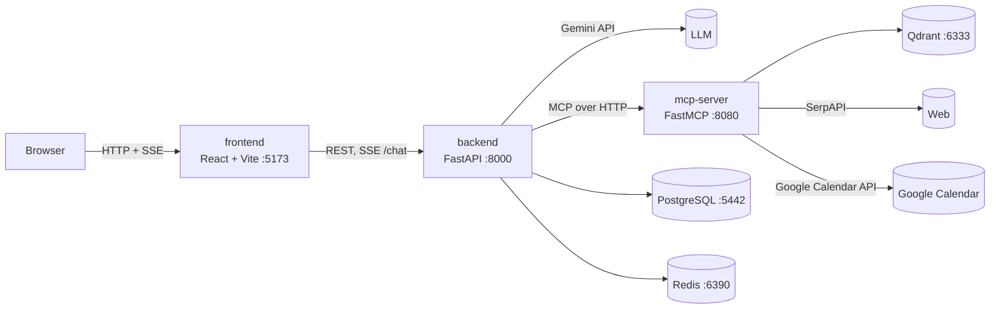

# Nutrition Virtual Assistant

A virtual assistant for nutrition advice and personal schedule management, built on a **planner–executor agent** architecture. Users chat in Vietnamese; the agent decides on its own when to look up nutrition documents (RAG), search the web, or act on Google Calendar, and then composes the answer.

## Features

- **Grounded nutrition Q&A**: hybrid search (dense BGE-M3 + sparse BM25) over Qdrant, re-ranked with `bge-reranker-v2-m3`.
- **Web search** through SerpAPI when the internal documents are not enough.
- **Google Calendar management**: create, list, update and delete events (including recurring ones), with a conflict check.
- **Autonomous tool choice**: the planner (Gemini) picks the tool, up to 5 rounds per turn; there is no manual "route" selector.
- **Your own documents**: upload a PDF and it is chunked and indexed into the vector store; questions can be restricted to selected documents.
- **Accounts and history**: sign up / sign in with email or Google; conversations are stored in PostgreSQL and cached in Redis.
- **Streaming**: answers and tool status ("searching the documents...") are pushed to the UI over SSE.
- **Clear error reporting**: formatted server logs; the UI shows a pop-up when the LLM, the tool server or the API fails.

## Architecture



| Service | Role |
|---|---|
| `frontend/` | Chat UI, conversation list, document upload, Google Calendar connection. |
| `backend/` | JWT auth, conversation storage, the agent loop (rewrite → planner ⇄ executor on LangGraph), Google OAuth. Never loads ML models itself. |
| `mcp-server/` | Owns every ML model (loaded once at startup) and exposes the MCP tools `rag_search`, `web_search`, `calendar_create`, `calendar_read`, `calendar_update`, `calendar_delete`. Also has an internal `/internal/ingest` route for loading PDFs. |
| `postgres/` | PostgreSQL 16 image with `pg_cron` preinstalled. |

A chat turn works like this: the backend rewrites the question into a standalone one (when there is history), the planner either answers directly or calls one tool, the executor calls that tool over MCP and feeds the result back to the planner, and the loop repeats until there is an answer. The user's Google token travels in an MCP request header and never appears in the tool arguments the LLM fills in.

## Tech stack

- **Backend**: Python 3.11, FastAPI, LangGraph, asyncpg, redis-py, PyJWT, bcrypt, sse-starlette, the `mcp` client.
- **mcp-server**: FastMCP, LangChain + Qdrant, sentence-transformers, FastEmbed, PyTorch, PyMuPDF, spaCy, Google API client.
- **Frontend**: React 19, TypeScript, Vite, Tailwind CSS 4, react-markdown, Vitest.
- **Infrastructure**: Docker Compose, PostgreSQL 16, Redis 7, Qdrant 1.12. Python dependencies are managed with [uv](https://docs.astral.sh/uv/).

## Repository layout

```text
.
├── backend/                 # FastAPI: auth, chat, agent loop
│   ├── app/
│   │   ├── agent/           # loop.py, mcp_client.py, prompts.py, parser.py, errors.py
│   │   ├── api/             # chat, conversations, documents
│   │   ├── auth/            # JWT, Google OAuth
│   │   ├── cache/  db/      # Redis and PostgreSQL access
│   │   └── llm_providers/   # Gemini, OpenAI-compatible
│   ├── migrations/          # SQL migrations, applied by scripts/migrate.py
│   └── tests/
├── mcp-server/              # MCP tools + ML models
│   ├── mcp_server/
│   │   └── tools/           # rag, web_search, calendar, registry
│   └── tests/
├── frontend/                # React + Vite
├── postgres/                # Postgres + pg_cron Dockerfile
├── docker-compose.yml       # runs the whole system
├── .env.example             # environment variable template
├── human-nutrition-text.pdf          # source book for RAG
└── graph_documents_nutrition.pkl     # knowledge graph extracted from the book (data, kept)
```

## Quick start with Docker Compose

Requirements: Docker Desktop. Give Docker at least 8 GB of RAM, because mcp-server loads ML models.

```bash
git clone https://github.com/phangiabao021003/Agentic-GraphRAG.git
cd Agentic-GraphRAG
cp .env.example .env        # then fill in the keys, see Environment variables
docker compose up -d --build
```

On the first run mcp-server downloads its models from Hugging Face (several GB, kept in the `mcp_hf_cache` volume), so it can take a few minutes to become `healthy`. The backend waits for mcp-server to be ready and applies the database migrations on startup.

```bash
docker compose ps               # wait until backend and mcp-server show (healthy)
docker compose logs -f backend  # follow the logs
```

Open http://localhost:5173, create an account, and upload `human-nutrition-text.pdf` from the document panel on the left so RAG has data to search.

Source code is bind-mounted into the containers, so code changes need no rebuild: backend and mcp-server reload automatically and the frontend uses Vite HMR. Run `docker compose build <service>` only after changing dependencies.

| Service | Local address |
|---|---|
| UI | http://localhost:5173 |
| Backend API (Swagger) | http://localhost:8000/docs |
| mcp-server | http://localhost:8080/health |
| Qdrant dashboard | http://localhost:6333/dashboard |
| PostgreSQL | `localhost:5442` (user/db `nutrition_va`) |
| Redis | `localhost:6390` |

## Environment variables

Everything lives in the `.env` file at the repository root (never commit it). The variables to fill in:

| Variable | Required | Description |
|---|---|---|
| `POSTGRES_PASSWORD` | yes | PostgreSQL password; update it inside `DATABASE_URL` too. |
| `JWT_SECRET` | yes | Long random string; signs access tokens and the OAuth `state` parameter. |
| `GOOGLE_TOKEN_ENCRYPTION_KEY` | yes | Fernet key that encrypts the Google tokens stored in the database. Generate it with the command below. |
| `GEMINI_API_KEY` | yes | [Google AI Studio](https://aistudio.google.com/) key for the planner. |
| `LLM_MODEL` | no | Defaults to `gemini-3.6-flash`. |
| `SERPAPI_API_KEY` | for web search | [SerpAPI](https://serpapi.com/) key. |
| `GOOGLE_OAUTH_CLIENT_ID`, `GOOGLE_OAUTH_CLIENT_SECRET` | for Google | OAuth client of type *Web application* in Google Cloud Console. |
| `GOOGLE_OAUTH_REDIRECT_URI` | for Google | Defaults to `http://localhost:8000/auth/google/callback`; register exactly the same value in Cloud Console. |
| `LOG_LEVEL` | no | `DEBUG`, `INFO` (default), `WARNING`, `ERROR`. |

```bash
# generate GOOGLE_TOKEN_ENCRYPTION_KEY
python -c "from cryptography.fernet import Fernet; print(Fernet.generate_key().decode())"
```

For Google OAuth, enable the **Google Calendar API** on the Cloud Console project. Google sign-in and Calendar connection share the same redirect URI.

## Development and testing

Each Python service has its own `pyproject.toml` and `uv.lock`.

```bash
# Backend: needs PostgreSQL and Redis running
docker compose up -d postgres redis
cd backend
uv sync
uv run python scripts/migrate.py
uv run pytest -q

# mcp-server: no infrastructure needed (tests do not load models)
cd mcp-server
uv sync
uv run pytest -q

# Frontend
cd frontend
npm ci
npx tsc -b
npx vitest run
npm run build
```

Note: the backend tests run against the real development database, so each run leaves a few test users behind.

## CI

The GitHub Actions workflow is in [.github/workflows/ci.yml](.github/workflows/ci.yml). It currently runs the mcp-server tests on every push to `main`. CI needs no real secrets because the tests mock Gemini, SerpAPI and Google.

## Troubleshooting

- **`port is already allocated` on startup**: another program holds the port (for example 8000). Stop it, or change the host port with `BACKEND_PORT` in `.env`.
- **mcp-server never becomes `healthy`**: the first run has to download the models; watch progress with `docker compose logs -f mcp-server`. If the container stops midway, check how much RAM Docker has.
- **Pop-up "Không kết nối được tới máy chủ công cụ" ("cannot reach the tool server")**: mcp-server is restarting or stopped. The agent still answers, but without tools.
- **Windows paths with non-ASCII characters**: `uv run pytest` may fail with `uv trampoline failed to canonicalize script path`; use `uv run python -m pytest` instead.
- **Docker project name**: `docker-compose.yml` pins `name: nutrition-va-agentic` so the data volumes are reused if the folder is renamed. Do not remove that line.

## Data

- `human-nutrition-text.pdf`: the *Human Nutrition* textbook used as the RAG knowledge source.
- `graph_documents_nutrition.pkl`: a knowledge graph (LangChain `GraphDocument`) extracted from the book by an earlier version. The current version does not query the graph, but the data is kept.
